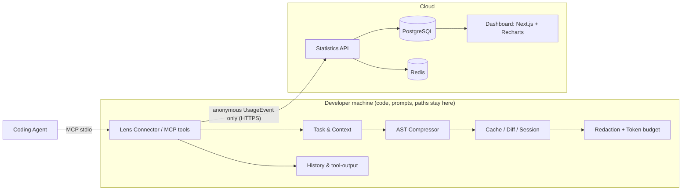
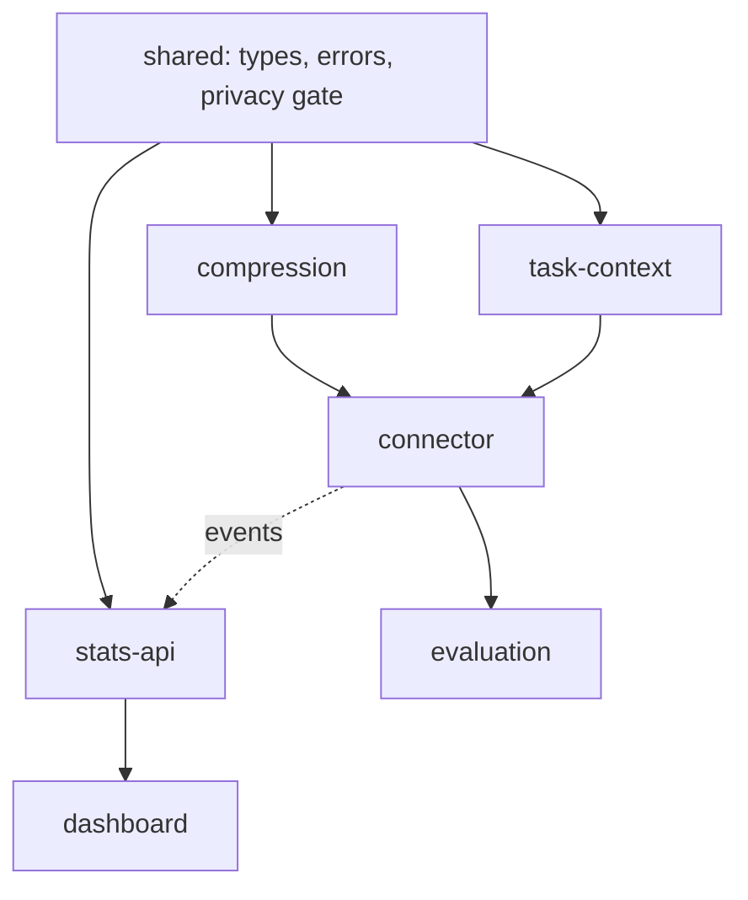

# LENS architecture

Source of truth: the graduation project proposal (12 Oct 2026). Items marked _(recommendation)_ are not in the proposal.

## Implementation status (end of Sprint 2)

The diagrams above show the target design from the proposal. Only the parts marked **implemented** exist in the code today.

| Part                                                    | Status                                                                         |
| ------------------------------------------------------- | ------------------------------------------------------------------------------ |
| Connector: `read_file_compressed`                       | Implemented (`light`; `signatures` for Python only)                            |
| Connector: `expand_symbol`                              | Implemented (Python only)                                                      |
| Connector: `prepare_task`, `search_code`, `get_summary` | Planned (contract only)                                                        |
| AST Compressor                                          | Implemented for Python; JavaScript/TypeScript grammars not bundled yet         |
| Task & Context, History & tool output                   | Planned                                                                        |
| Cache / Diff / Session                                  | Planned                                                                        |
| Redaction                                               | Planned, not implemented (secrets pass through in both tools)                  |
| Token counter                                           | Implemented (`js-tiktoken`, `cl100k_base`, estimate)                           |
| `UsageEvent` + privacy gate                             | Implemented                                                                    |
| Connector sending events to the API                     | Planned (events are only produced locally and logged with `LENS_DEBUG`)        |
| Statistics API + PostgreSQL                             | Implemented (minimal, no authentication or rate limiting)                      |
| Redis                                                   | Planned and ADR 0004 is still Proposed (the container starts, no code uses it) |
| Dashboard, evaluation harness                           | Planned / placeholder                                                          |

Open design question (redaction order): the diagram above puts redaction after the cache, while `docs/research/secrets.md` recommends redacting before token counting and caching so secrets never sit in the cache. Decide this before the redaction sprint.

Boundary rules: only `@lens/shared` is imported by every package; `UsageEvent` is the only data that crosses to the cloud; `parseUsageEvent` is the allow-list gate on both sender and receiver.

## AST compressor: syntax-error fallback (S2-07)

Real files are messy. The compressor must never crash and must never hide code because the parser failed.

**Rule:** if the parse tree sets `hasSyntaxError`, return the file **unchanged** with `level: 'raw'` and a `warning` on `CompressResult`. Do not extract symbols or strip bodies from a broken tree. A parser problem is not a reason to omit source — the agent still needs the original text.

Valid trees continue to the signatures renderer as usual. Callers must still dispose parse trees (`ParsedFile.dispose` / `withParsedFile`) so WASM memory is released after each file.
