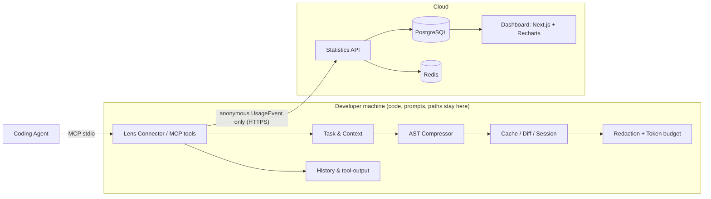
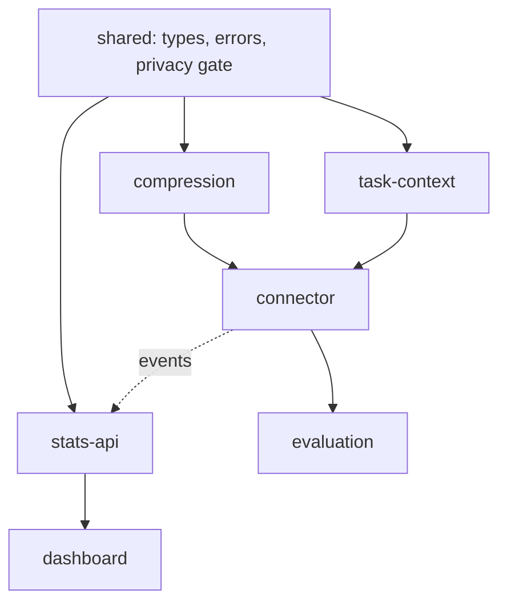

# LENS architecture (Sprint 1 baseline)

Source of truth: the graduation project proposal (12 Oct 2026). Items marked _(recommendation)_ are not in the proposal.

Boundary rules: only `@lens/shared` is imported by every package; `UsageEvent` is the only data that crosses to the cloud; `parseUsageEvent` is the allow-list gate on both sender and receiver.
